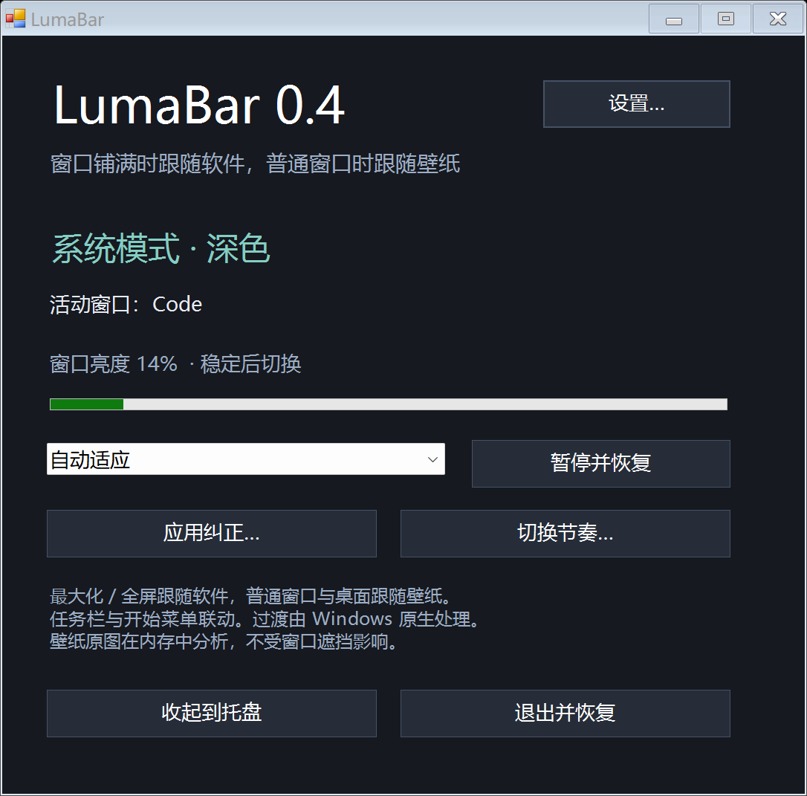
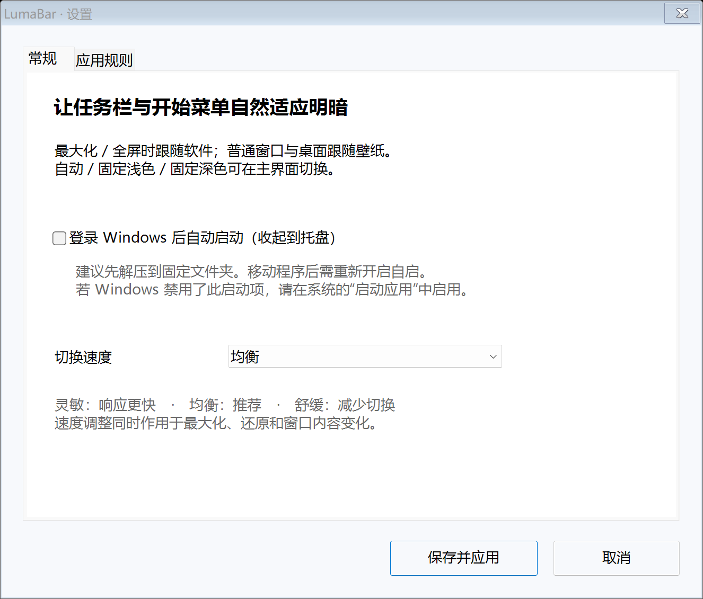
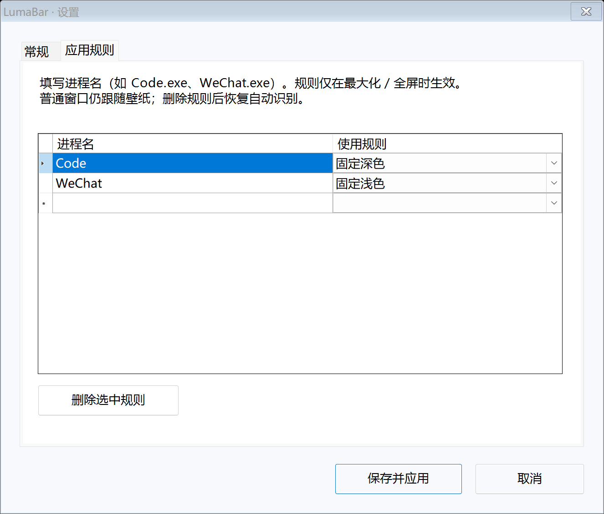

# LumaBar 0.4 — Windows 11 自适应任务栏

根据最大化窗口或桌面壁纸的明暗，自动切换 Windows 11 任务栏、开始菜单和快捷设置。

**[下载最新版](https://github.com/bin-art-666/LumaBar/releases/latest)** · [验证记录](VALIDATION.md) · [MIT 许可证](LICENSE)



<details>
<summary>查看常规设置与应用规则</summary>




</details>

0.4 新增图形设置页与可选开机自启。在主界面点击“设置…”或从托盘打开“设置…”，可以调整切换速度、管理应用规则，或开启“登录 Windows 后自动启动”。保存后立即生效，取消则不保存。高级参数仍可在 settings.json 中调整。

## 开机自启与设置

- 自启默认关闭。先将程序解压到固定、可写的文件夹，再在“设置 → 常规”勾选自启并保存。登录后使用 `--startup` 静默进入托盘，双击托盘图标打开主界面。
- 自启仅登记当前用户的 `HKCU\Software\Microsoft\Windows\CurrentVersion\Run` 下 `LumaBar` 项，包含带引号的程序完整路径，无需管理员。取消勾选并保存即可移除该项；退出程序不会取消已开启的自启。
- 移动或升级到新目录后，在新副本的设置中保存自启选项以更新路径。删除程序前先关闭自启。若 Windows 的“启动应用”禁用了 LumaBar，需在系统设置中重新启用。
- “常规”提供灵敏、均衡、舒缓三种速度；高级配置与预设不一致时显示“自定义”，直接保存会保留原参数。
- “应用规则”可填写进程名并选择自动、浅色、深色或保持原模式。可新增、删除，重复或空白进程名会提示修正。这些规则仅在最大化 / 全屏时生效。
- 主界面保留自动、固定浅色、固定深色与仅检测模式，以及暂停、退出恢复操作。启动时仍默认自动适应；手动固定模式不跨重启保存。

0.3.1 加速：用一次 96 × 64 的内存缩略图取代逐点读屏，取样耗时在本机合成窗口测试中由约 669 ms 降至约 41–43 ms。最大化 / 还原触发壁纸、软件来源转换时，自动短暂提高检测频率，使用独立的快速确认与冷却；软件内部画面变化仍保持较慢的防闪烁策略。实际任务栏完成重绘的时间还取决于 Windows。

0.3 改为两种场景：**最大化 / 全屏时跟随软件；普通窗口、半屏分屏和桌面时跟随壁纸**。壁纸从 Windows 提供的原图读取，不受窗口或桌面图标遮挡影响。保留任务栏、开始菜单联动，应用纠正、三种节奏及退出恢复。

窗口铺满屏幕时，按软件实际亮度自动切换系统浅色 / 深色，例如最大化的浅色微信、深色 VS Code。将窗口还原后，切换依据回到所在屏幕的壁纸，亮壁纸用浅色，暗壁纸用深色。普通窗口的颜色与按应用纠正规则不影响壁纸模式。

采用 Windows 系统模式切换后端，**任务栏、开始菜单、快捷设置一起切换浅色 / 深色**，所有显示器共用一个模式。过渡由 Windows 原生处理，没有自定义的逐帧渐变或渐变时长。

## 运行

1. 将整个目录解压到可写文件夹，保留 `LumaBar.exe`、`LumaBar.exe.config`、`settings.json` 在同一目录。
2. 如果已运行 TranslucentTB、Auto Dark Mode、Windhawk 的任务栏样式模块等，先从它们的菜单暂停或退出，以便观察原生任务栏的切换。
3. 双击 `LumaBar.exe`，然后点击“收起到托盘”。最大化 / 全屏后跟随软件，还原后跟随壁纸。均衡模式在来源转换时使用 180 ms 快速确认，并短暂按 75 ms 间隔检测；加上初次检测和取样、重绘耗时，实际响应会更长。同一来源内部的变化仍保留较长的确认与冷却。
4. 双击托盘图标打开面板；“暂停并恢复”会恢复本次运行前的系统模式，“退出并恢复”会恢复并退出。关闭面板的 × 只是收起到托盘。

从旧版升级时先从旧版托盘选择“退出并恢复”，再运行新版本。如果系统模式与任务栏外观不同步，可以从托盘选择“重新同步任务栏”。

无需管理员、无需安装额外 NuGet 包、无需 .NET SDK。运行环境为 Windows 11 和 .NET Framework 4.8。目录需可写，否则程序不能在改变主题之前保存恢复记录，会停止更改。开机启动仅在设置中主动开启后登记；程序没有注入 Explorer、没有网络请求。

如需先观察判断结果而不自动切换，在命令行运行：

```powershell
.\LumaBar.exe --monitor
```

也可以在面板选择“仅检测（不修改）”。其他可选模式为“固定浅色”和“固定深色”。仅检测模式仍会在启动时处理上次异常退出遗留的恢复记录。

## 如何判断

- 先识别窗口状态：Windows 标记为最大化，或者可见边界覆盖所在显示器 / 整个工作区，才使用软件颜色。普通悬浮窗口和半屏分屏使用壁纸。
- 桌面也使用壁纸。开始菜单、托盘菜单、LumaBar 自己的面板和临时对话框继续保持当前模式，避免操作系统界面本身反过来触发切换。
- 软件模式使用下面的窗口取样；壁纸模式直接分析 Windows 返回的壁纸原图，方法见下一节。

- 均衡模式平时每 350 毫秒生成一次 96 × 64 的内存窗口缩略图，在其中最多 77 个点按下部、正文和顶部分区取中位数，再以 65% / 25% / 10% 权重合并。下部横跨整个窗口取样，减少窄侧栏影响，也避开最底部的一条状态栏。缩略图在本次取样后立即释放，不保存到磁盘。
- 使用 `WindowFromPoint` 检查取样点确实属于活动窗口，不把任务栏、覆盖窗口或屏幕外区域当作背景。高饱和度像素不参与判断；任一区域有效取样不足时保持现状。
- 再对最近最多三帧取中位数。亮度低于 44% 倾向深色，高于 60% 倾向浅色；中间区间保持原状。如果近期画面亮度跨度过大，则重新等待。
- 壁纸与软件来源转换时，均衡模式等待 180 毫秒，并允许以 400 毫秒最短间隔切换。首次进入一个来源也使用快速路径。来源已稳定后立即退出快速路径，避免同一窗口的视频帧误用快速切换。
- 同一软件来源内切换应用，默认稳定等待 700 毫秒；已停留窗口内的内容变化默认等待 1400 毫秒，至少三次有效取样，最短切换间隔 1800 毫秒。快速来源转换仍需至少两次有效取样，不能直接靠一次瞬时画面改色。
- 按住 Alt 切换窗口时暂缓判断；窗口换来换去、有效取样中断时重新确认。带可见同进程所有者的临时弹窗默认保持主窗口进入前的明暗，不因白色对话框立刻改色。
- 软件模式默认让常见独立播放器（VLC、mpv、PotPlayer、旧版 Windows Media Player、部分新版 Media Player 进程名）保持进入前的明暗。可用应用纠正规则选深 / 浅色，或关闭 `HoldMediaPlayers` 后恢复自动取样。浏览器中的视频不保证能识别，亮度波动过滤会减少误切。
- 默认忽略自己的设置窗口、开始菜单、搜索、任务管理器等系统界面。真正全屏现在会进行软件判断，旧版 `PauseOnFullscreen` 设置已不再使用。
- 在锁屏、休眠和高对比度模式时释放主题更改，恢复后重新稳定判断。

只读取像素的 RGB 数值，取样结果仅在内存中用于判断。**不保存截图，不读取窗口文字内容，不做 OCR。** 日志只记录启动、退出和错误；错误堆栈可能含程序所在路径。

## 壁纸模式

通过 Windows `IDesktopWallpaper` 查询当前屏幕的壁纸、显示方式和桌面背景色，按居中、平铺、拉伸、适应、填充或跨屏的显示布局取样。不可见的裁剪部分不参与判断，适应模式的背景色边框会参与。纯色背景直接使用背景色。

对整个屏幕对应的壁纸区域取样 64 × 40 点，按亮度中位数分类：大于等于 50% 为浅色，低于 50% 为深色。不必先露出桌面，也不会因前面的黑色 / 白色窗口而误读。

壁纸信息每 2 秒复查；文件、修改时间、显示方式、背景色或显示器布局发生变化时才重新解码。窗口之间切换仍使用同一屏幕的壁纸判断上下文，减少重复等待。

多屏时使用活动窗口所在屏幕的壁纸，但系统明暗设置仍统一影响所有任务栏。Shell 壁纸接口不可用时，回退到 Windows 的通用 / 主屏壁纸 API；此时不能保证各屏使用不同壁纸的映射。无法读取原图时保持当前模式并在面板说明，不使用被窗口遮挡的桌面截图猜测。

第三方动态 / 视频壁纸通常只能读到 Windows 配置的静态底图，不保证能反映动态画面。

## 应用纠正与切换节奏

先切到目标应用，再打开 LumaBar 的“应用纠正…”或托盘同名菜单。菜单会明确显示目标进程，可以选择：

- 自动识别：移除该应用的手动规则。
- 此应用使用浅色 / 深色：窗口最大化或全屏时，使用指定明暗；仍等待窗口稳定并遵守暂停与弹窗保护。
- 保持进入前的明暗：该应用最大化或全屏时保持当前系统模式。

目标是最近 30 秒内识别到的应用；设置窗口、开始菜单不会替换目标。超过时间后请重新切到目标应用。规则按进程名保存，同一应用的所有铺满窗口共用，重启后仍有效。普通窗口始终以壁纸为准。面板的固定深色 / 浅色模式仍可手动覆盖整个自动策略。

“切换节奏…”提供三个预设，修改后立即生效并保存：

| 节奏 | 检测间隔 | 新窗口等待 | 窗口内变化等待 | 最短切换间隔 |
|---|---:|---:|---:|---:|
| 灵敏 | 200 ms | 450 ms | 900 ms | 1200 ms |
| 均衡（默认） | 350 ms | 700 ms | 1400 ms | 1800 ms |
| 舒缓 | 400 ms | 1000 ms | 2000 ms | 2600 ms |

这些是确认时间和节流参数，不是渐变动画时长。对于图片、视频较多的工作，建议舒缓或为相应应用选择保持明暗。

上表是常规软件 / 内容变化的参数。对于最大化、还原造成的“壁纸 ↔ 软件”来源转换，灵敏 / 均衡 / 舒缓分别使用 120 / 180 / 300 ms 确认、250 / 400 / 700 ms 最短间隔。检测到来源改变后，会有约 1 秒的 75 ms 检测间隔；之后回到常规间隔。

## 主题更改与恢复

唯一修改的注册表设置是当前用户的：

```text
HKCU\Software\Microsoft\Windows\CurrentVersion\Themes\Personalize
SystemUsesLightTheme = 0 或 1
```

程序不写 `AppsUseLightTheme`，不改主题色、壁纸、透明度，也不会重启 Explorer。向任务栏和 Explorer 的其他顶层宿主发送 `WM_SETTINGCHANGE / ImmersiveColorSet` 与 `TraySettings`，再向其他顶层窗口发送主题通知。通知有单窗口超时和整体时间预算，避免某个无响应窗口无限阻塞刷新。启动时即使系统模式的值已经匹配，也会重新请求同步；托盘提供手动同步入口。

Windows 的实际刷新时机和视觉效果取决于系统版本及现有主题设置。通知成功送达不等于已经验证屏幕颜色，日志会区分这一点。

`session.json` 在写注册表之前保存原始值、上次写入值与即将写入值。正常暂停、退出时恢复原值；进程被强制结束后，主题可能暂时保留在最后一次设置，**下次启动会尝试恢复**。也可运行：

```powershell
.\LumaBar.exe --restore
```

恢复成功后删除恢复记录。如果检测到当前值与程序最后管理的值不同，会保留外部更改并暂停，避免覆盖你的新选择。仅凭一个二进制注册表值无法区分其他软件写入了相同值的情况，因此仍建议暂停其他自动主题工具。不要在程序运行期间删除 `session.json`，也不要复制正在运行的目录作为第二个工作副本。

## 设置

面板与托盘菜单中的规则、节奏选择即时保存生效。手工修改 `settings.json` 后需重启；不要在外部编辑尚未保存时同时使用菜单保存设置。所有时间单位为毫秒。

| 参数 | 默认值 | 范围 / 含义 |
|---|---:|---|
| `PollMilliseconds` | 350 | 150–3000，检测间隔 |
| `StableMilliseconds` | 700 | 200–5000，稳定等待时间 |
| `ContentStableMilliseconds` | 1400 | 大于等于新窗口等待时间，最大 8000；同一窗口内变化的等待时间 |
| `MinimumSwitchMilliseconds` | 1800 | 800–15000，两次自动切换最短间隔 |
| `SourceStableMilliseconds` | 180 | 80–1000，壁纸 / 软件来源转换时的确认时间 |
| `SourceMinimumSwitchMilliseconds` | 400 | 200–2000，来源转换时的最短切换间隔 |
| `DarkThreshold` | 0.44 | 大于等于 0.1，且低于浅色阈值 |
| `LightThreshold` | 0.60 | 小于等于 0.9，且高于深色阈值 |
| `HoldOwnedDialogs` | true | 有可见同进程所有者的临时弹窗保持现状 |
| `HoldMediaPlayers` | true | 常见独立播放器默认保持现状 |
| `ApplicationRules` | {} | 进程名映射到 `auto` / `light` / `dark` / `hold` |
| `IgnoredProcesses` | [] | 忽略的进程名，例如 `["Photoshop.exe", "vlc.exe"]` |

## 已知限制

- 自动明暗判断是像素启发式，不是读取应用的主题 API。混合明暗布局、图片编辑、视频、透明窗口、HDR、远程桌面或禁止取样的窗口可能误判或无法取样。可以加入忽略列表或临时固定模式。
- 系统模式的切换速度和过渡由 Windows 控制，不能保证鸿蒙同款的平滑动画。自定义系统强调色、其他任务栏工具也可能改变最终观感。
- 单个活动窗口控制所有显示器上的系统模式；尚未做每个显示器独立任务栏配色。
- 沿用 0.1.1 已实机验证的主题通知后端：当时任务栏背景亮度由 0.145 升到 0.901，并恢复原模式。后续新增部分通过逻辑检查与可见合成窗口验证，尚未完成各 Windows 版本及真实微信 / VS Code 组合的完整外观验收。

## 构建与测试

在项目根目录执行：

```powershell
.\build.ps1
```

脚本使用 Windows 自带 .NET Framework C# 编译器，生成 `LumaBar.exe`，然后运行逻辑测试。也提供 `LumaBar.csproj`，可用装有 .NET Framework 4.8 开发工具的 Visual Studio / MSBuild 打开和构建。

```powershell
# 展示一个测试窗口，验证深色变浅色时能实际读取新的像素；不修改真实主题。
.\tests\bin\LumaBar.Tests.exe --native

# 使用内存主题后端启动托盘程序，再自动退出；不修改真实主题。
.\tests\bin\LumaBar.Tests.exe --smoke

# 只读查询本机当前主屏壁纸并打印亮度，不更改壁纸或主题。
.\tests\bin\LumaBar.Tests.exe --wallpaper

# 实际切换系统深浅色、读取任务栏背景亮度、最后恢复原值。
# 先退出所有 LumaBar 副本；此项会短暂改变屏幕中的系统界面明暗。
.\tests\bin\LumaBar.Tests.exe --shell
```

文件结构：`src/Core.cs` 是亮度、防闪烁和可恢复主题事务；`src/Native.cs` 是窗口状态路由、Win32 取样和任务栏通知；`src/Wallpaper.cs` 是屏幕覆盖判定与壁纸原图分析；`src/Storage.cs` 是注册表与原子恢复记录；`src/App.cs` 是托盘和控制面板；`tests/Tests.cs` 是测试。

## 技术参考

- [Microsoft：Win32 明暗主题](https://learn.microsoft.com/en-us/windows/apps/desktop/modernize/apply-windows-themes)
- [Microsoft：WM_SETTINGCHANGE](https://learn.microsoft.com/en-us/windows/win32/winmsg/wm-settingchange)
- [Microsoft：IDesktopWallpaper](https://learn.microsoft.com/en-us/windows/win32/api/shobjidl_core/nn-shobjidl_core-idesktopwallpaper)
- [Microsoft：壁纸显示位置](https://learn.microsoft.com/en-us/windows/win32/api/shobjidl_core/ne-shobjidl_core-desktop_wallpaper_position)
- [Microsoft：广播超时会按每个窗口累计](https://learn.microsoft.com/en-us/windows-hardware/drivers/devtest/28602-avoid-calling-sendmessagetimeout-with-hwnd-broadcast)
- [WinDynamicDesktop 社区脚本中的系统模式切换实现](https://github.com/t1m0thyj/WDD-scripts/blob/master/stable/ChangeWindowsSystemTheme.ps1)

MIT License。该项目为独立实现，与华为、鸿蒙及 TranslucentTB 无隶属关系。
