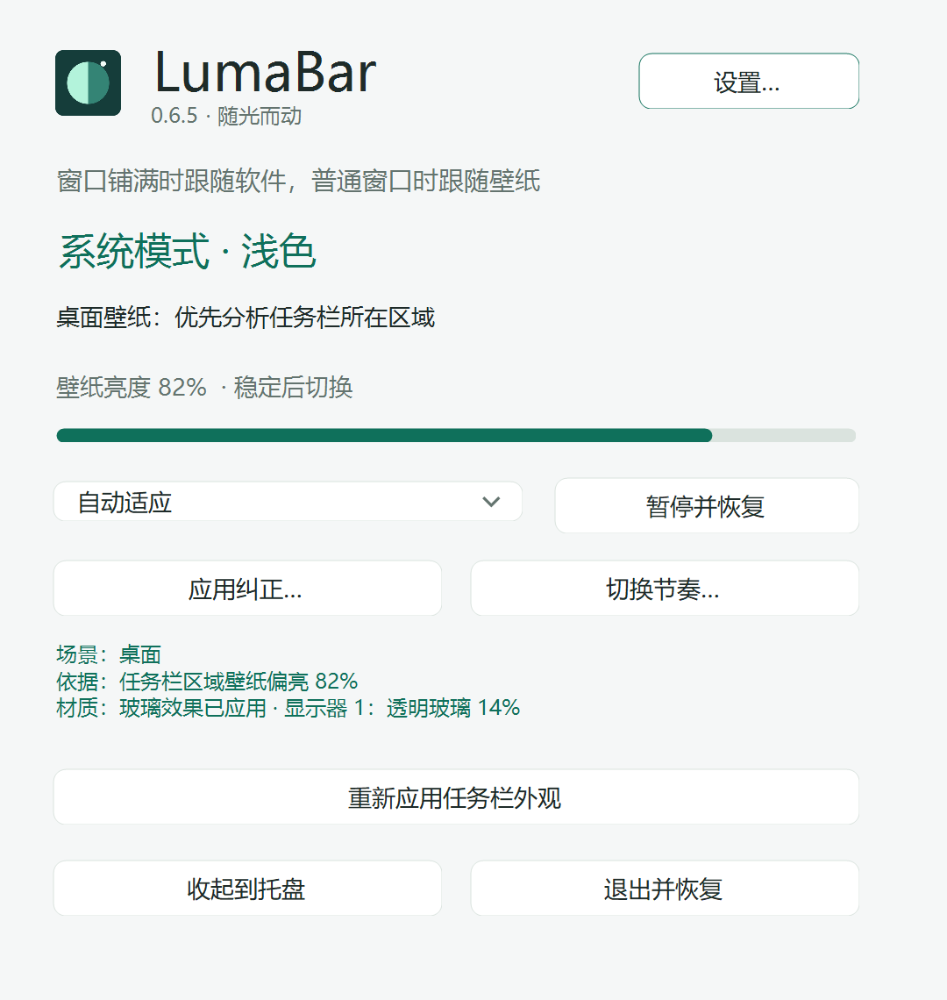
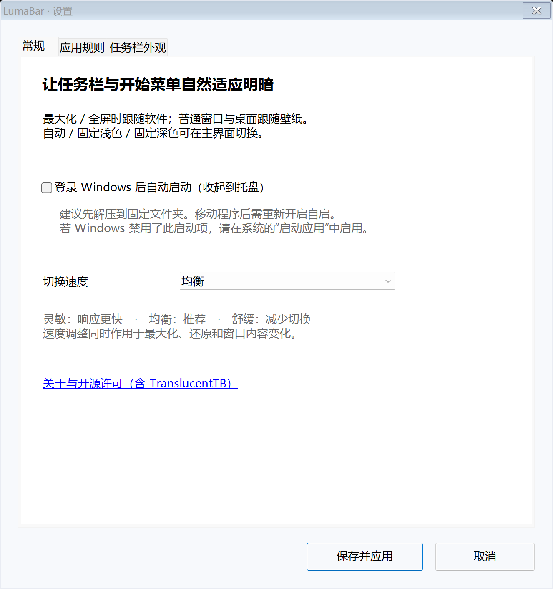
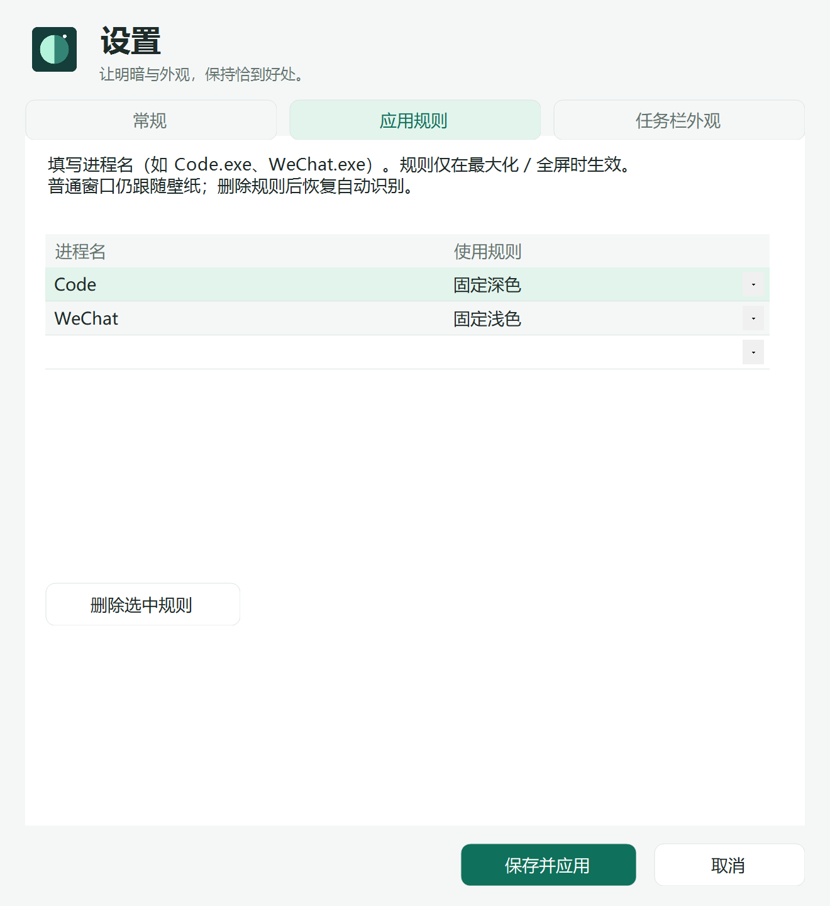
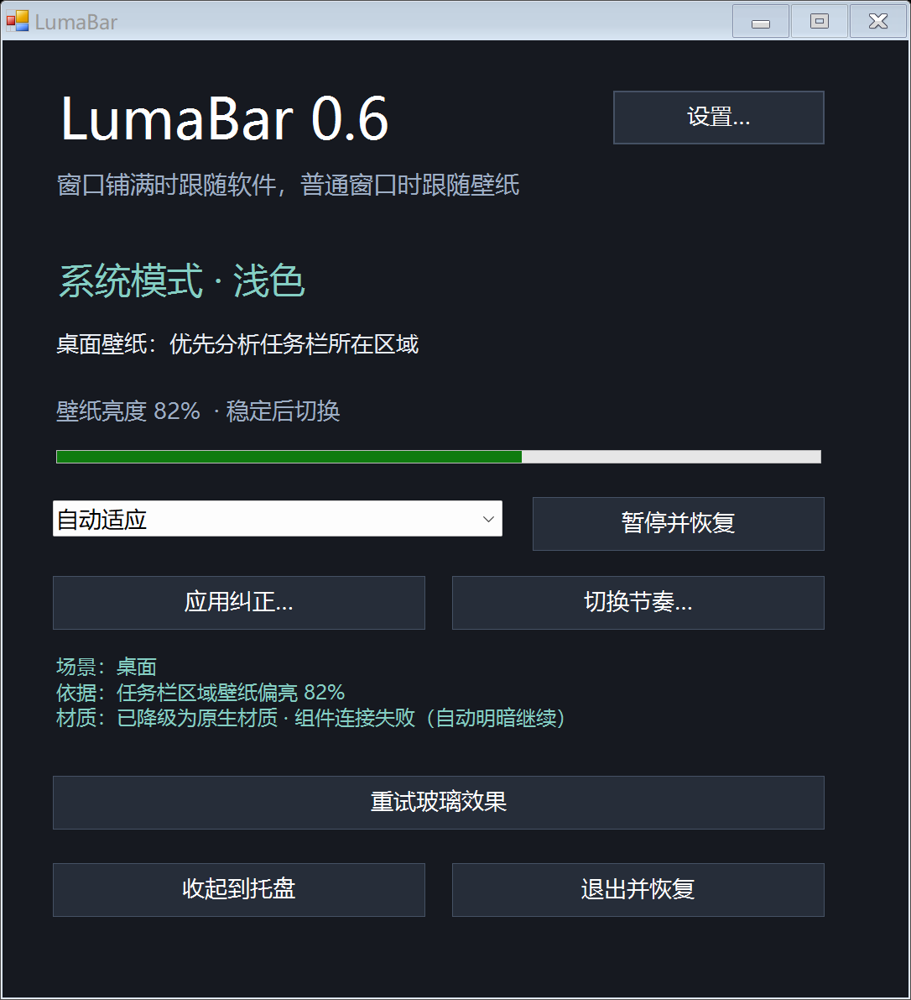
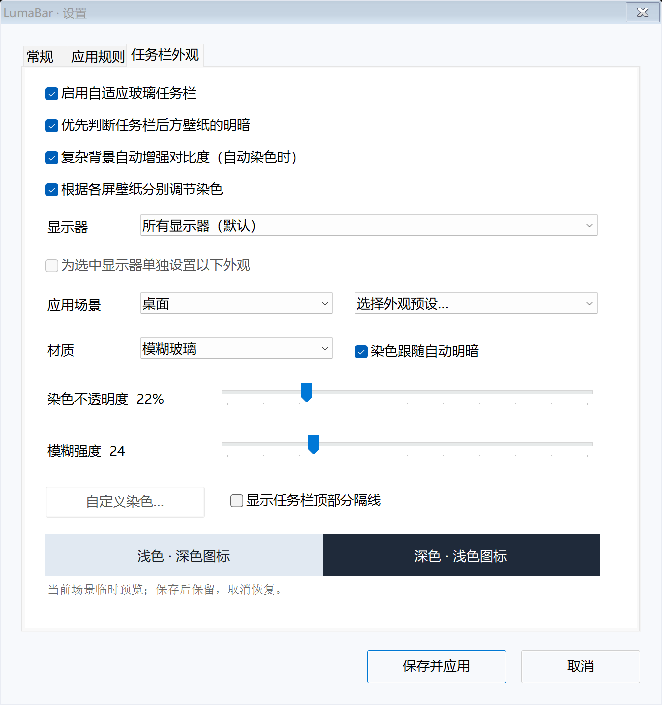

# LumaBar 0.6.1 — 自动明暗与玻璃任务栏

根据最大化窗口或桌面壁纸的明暗，自动切换 Windows 11 任务栏、开始菜单和快捷设置，并为任务栏叠加可调的透明、模糊和亚克力材质。

**[下载 0.6 预览版](https://github.com/bin-art-666/LumaBar/releases/tag/v0.6.0)** · [0.4 稳定版](https://github.com/bin-art-666/LumaBar/releases/tag/v0.4.0) · [验证记录](VALIDATION.md) · [GPL-3.0 许可证](LICENSE) · [第三方声明](THIRD_PARTY_NOTICES.md)



<details>
<summary>查看常规设置与应用规则</summary>




</details>

0.4 新增图形设置页与可选开机自启。在主界面点击“设置…”或从托盘打开“设置…”，可以调整切换速度、管理应用规则，或开启“登录 Windows 后自动启动”。保存后立即生效，取消则不保存。高级参数仍可在 settings.json 中调整。

## 0.6.1：恢复 0.4 明暗切换（2026-11-01）

- 恢复 `v0.4.0` 的明暗判定、三档速度、75 ms 来源切换取样、整屏壁纸判断与同步主题通知。移除窗口事件驱动的 50 ms 加速。
- 均衡来源确认恢复 180 ms，来源切换间隔 400 ms；新版标准速度自动迁移，自定义高级时间参数保留。
- 玻璃材质、染色不透明度、模糊、对比度保护、多屏外观及预览配置保持原样。任务栏区域壁纸选项用于玻璃染色取样；系统明暗使用 0.4 整屏壁纸策略。
- 本机统一运行目录为 `D:\APP\LumaBar`，仅保留当前程序及一个注册表自启入口。开发源码保留在 `D:\Develop\Windows\LumaBar`。

GitHub `main` 包含本次修改；下方 v0.6.0 / v0.4.0 下载链接为历史发布，不包含 0.6.1。构建当前源码请运行 `build.ps1`，打包请运行 `package.ps1`；输出包以 0.6.1 命名。下面的 0.5.1 响应提速说明属于历史版本。

## 0.6：可读性与稳定性

- **复杂背景保护**：在“设置 → 任务栏外观”启用“复杂背景自动增强对比度”。壁纸分析保留暗部 / 亮部尾部信息，根据当前全局图标文字模式计算最低染色强度；黑白交错、照片或另一块屏幕与全局模式不匹配时，临时提高实际不透明度。保存的透明度始终保留，安全背景下按原值显示。可关闭此选项；手动自定义染色、纯色和系统默认材质不受该保护调整。
- **协调切换**：场景至少经过两次有效观察，并等待目标系统明暗确认后，才提交新的材质场景。快速最大化 / 还原不会立即闪过另一种材质；明暗变化前取消尚未执行的旧材质请求，连接过程中收到的旧模式也不会覆盖新模式。Windows 自身的字体与背景重绘仍非原子操作，不能保证完全无闪烁。
- **明确状态**：主界面分开显示当前已确认场景、判断依据、材质应用结果；多屏显示实际材质和染色百分比。悬停可查看完整信息。连接中、应用中、原生材质、降级及恢复未确认有不同提示。状态依据组件调用结果，不是持续截屏验证。
- **降级与重试**：组件连接 / 应用报告失败时尝试恢复原生画刷，自动明暗保持运行；主界面和托盘可一键重试。失败后不再每两秒重新注入；手动重试、Explorer 进程变化或任务栏拓扑变化时重新尝试。若恢复本身失败，会明确显示“恢复未确认”，不会声称已恢复。暂停 / 退出时即使材质恢复报错，仍尝试恢复系统主题。
- **各屏外观**：默认按各屏任务栏背后的壁纸分别计算染色强度。在“显示器”选择某屏并勾选“为选中显示器单独设置”，可独立配置其桌面、普通窗口和最大化场景的材质、颜色、不透明度、模糊和分隔线。未单独设置的显示器继承默认。关闭各屏模式后回到统一外观，单屏配置仍保留。

所有屏幕仍共用活动窗口选定的场景和 Windows 系统明暗 / 图标文字模式。各屏通过不同材质与染色改善可读性，不是为每屏单独修改 Windows 主题。显示器配置按 Windows 设备名保存；连接方式改变后若设备名改变，可重新选择对应显示器。

对比度保护使用壁纸亮度统计启发式，不是逐个图标或 WCAG 对比度认证，也不读取窗口文字。动态壁纸、被窗口覆盖的透明任务栏背景仍有原有局限。当前实机为单屏，双屏独立参数与恢复使用模拟目标验证；尚未完成真实双屏 / 热插拔 / 系统更新的整体验收。




## 0.5.1：更快的场景响应

- 窗口切换、最大化 / 还原及最小化事件触发提前检测，随后短暂按 50 ms 节奏取样；不必先等下一次 200–400 ms 常规轮询。事件不可用时仍有轮询兜底。
- 桌面 ↔ 最大化窗口、不同最大化应用之间，以及壁纸变更都使用快速场景确认。灵敏 / 均衡 / 舒缓分别等待 80 / 120 / 180 ms，最短切换间隔为 200 / 250 / 400 ms。仍需连续有效取样，Alt 切换、弹窗、播放器和内容波动保护保持有效。
- 同一窗口内的内容变化保留原来的防闪烁参数，不因窗口事件而直接跳过确认。
- 任务栏优先同步刷新，其他 Explorer / 系统宿主和应用窗口由单个后台工作线程按优先级通知；连续刷新合并，后台总预算保留 1200 ms，避免阻塞取样和材质重应用。退出时给恢复通知最多额外 1500 ms 完成时间。
- 壁纸桌面设置通知使缓存立即失效；另每 500 ms 复查指纹，只有变化时才重新解码。壁纸重新分析后使用新的判断上下文，避免套用同一窗口内容的长等待。
- 自动升级旧版三个标准速度预设的来源切换参数；自定义高级参数和玻璃外观保留。`TimingVersion` 记录迁移版本，不需要手动修改。

本机正常桌面权限下的只读刷新测试中，检测线程的同步刷新段为 95 ms；旧版运行日志中同步通知所有窗口常见约 0.5–1.2 秒。这是通知调用耗时比较，**不是端到端视觉切换延迟保证**，最终重绘仍由 Windows 处理。

## 0.5：自适应玻璃任务栏

从 [0.6 预览版 Release](https://github.com/bin-art-666/LumaBar/releases/tag/v0.6.0) 下载 `LumaBar-0.6-preview-x64.zip`，完整解压后运行其中的 `LumaBar.exe`。升级前先从旧版托盘选择“退出并恢复”，并退出独立 TranslucentTB。源码附件 `LumaBar-0.6-source.zip` 包含固定版本的原生组件对应源码；GitHub 自动生成的 Source code 包不展开子模块。

- 一个托盘程序协调自动明暗和任务栏材质，无需另开 TranslucentTB。集成其官方 2026.2 x64 `ExplorerTAP.dll`，不是重绘覆盖层。
- 在“设置 → 任务栏外观”分别配置桌面、普通窗口 / 分屏、最大化 / 全屏。桌面与普通窗口默认柔和磨砂；最大化默认原生材质，仍跟随应用内容的明暗。
- 材质包括系统默认、透明玻璃、模糊玻璃、亚克力与纯色。支持自动 / 自定义染色、0–100% 染色不透明度、模糊强度和顶部分隔线。模糊强度仅对“模糊玻璃”有效；亚克力使用其自身材质。纯色始终不透明。
- 提供清透玻璃、柔和磨砂、浓厚亚克力和系统默认预设。下方色块说明深浅配色，实际任务栏预览只作用于当前场景。保存保留设置；取消恢复保存前的材质。仅检测模式、暂停、锁屏、休眠及高对比度状态下不预览材质。
- 普通窗口 / 桌面默认优先分析任务栏所在位置对应的壁纸原图区域，而不是整张壁纸，解决上部暗、底部亮时的错误判断；可取消该选项恢复全屏壁纸判断。自动隐藏时使用底部可见尺寸的取样带。
- 自动染色跟随系统浅色 / 深色模式；任务栏图标文字由 Windows 原生模式负责。开始菜单和快捷设置继续跟随系统明暗，材质保持 Windows 默认。
- 暂停、退出、锁屏、休眠和高对比度时恢复原生材质。原生组件还监视 LumaBar 进程，进程异常退出后恢复原画刷。材质连接在独立线程执行，连接失败会显示状态，自动明暗仍可工作。

当前支持 Windows 11 x64 原生 XAML 任务栏，本机验证为构建 26300.9818。不支持 ARM64 或替换的经典任务栏。多屏共用活动窗口选定的场景与系统明暗，各屏可独立设置材质与染色。普通窗口遮住任务栏后方时，目前仍按静态壁纸判断；复杂图片和动态壁纸下仍可能需要提高染色不透明度。

原生组件通过 Explorer 内部 XAML 接口加载，系统更新可能影响兼容性；首次连接可能等待约 35 秒，界面可继续使用。DLL 在 Explorer 中会保留到 Explorer 重启或注销，不要在载入后移动 / 删除其目录。程序不会自动重启 Explorer，也不会修改其他任务栏工具的配置。上游来源、校验值与对应源码见 [native/README.md](native/README.md)。



## 开机自启与设置

- 自启默认关闭。先将程序解压到固定、可写的文件夹，再在“设置 → 常规”勾选自启并保存。登录后使用 `--startup` 静默进入托盘，双击托盘图标打开主界面。
- 自启仅登记当前用户的 `HKCU\Software\Microsoft\Windows\CurrentVersion\Run` 下 `LumaBar` 项，包含带引号的程序完整路径，无需管理员。取消勾选并保存即可移除该项；退出程序不会取消已开启的自启。
- 移动或升级到新目录后，在新副本的设置中保存自启选项以更新路径。删除程序前先关闭自启。若 Windows 的“启动应用”禁用了 LumaBar，需在系统设置中重新启用。
- “常规”提供灵敏、均衡、舒缓三种速度；高级配置与预设不一致时显示“自定义”，直接保存会保留原参数。
- “应用规则”可填写进程名并选择自动、浅色、深色或保持原模式。可新增、删除，重复或空白进程名会提示修正。这些规则仅在最大化 / 全屏时生效。
- 主界面保留自动、固定浅色、固定深色与仅检测模式，以及暂停、退出恢复操作。启动时仍默认自动适应；手动固定模式不跨重启保存。

0.3.1 加速：用一次 96 × 64 的内存缩略图取代逐点读屏，取样耗时在本机合成窗口测试中由约 669 ms 降至约 41–43 ms。最大化 / 还原触发壁纸、软件来源转换时，自动短暂提高检测频率，使用独立的快速确认与冷却；软件内部画面变化仍保持较慢的防闪烁策略。实际任务栏完成重绘的时间还取决于 Windows。

0.3 改为两种场景：**最大化 / 全屏时跟随软件；普通窗口、半屏分屏和桌面时跟随壁纸**。壁纸从 Windows 提供的原图读取，不受窗口或桌面图标遮挡影响。保留任务栏、开始菜单联动，应用纠正、三种节奏及退出恢复。

窗口铺满屏幕时，按软件实际亮度自动切换系统浅色 / 深色，例如最大化的浅色微信、深色 VS Code。将窗口还原后，切换依据回到所在屏幕的壁纸，亮壁纸用浅色，暗壁纸用深色。普通窗口的颜色与按应用纠正规则不影响壁纸模式。

采用 Windows 系统模式切换后端，**任务栏、开始菜单、快捷设置一起切换浅色 / 深色**，所有显示器共用一个模式。过渡由 Windows 原生处理，没有自定义的逐帧渐变或渐变时长。

## 运行

1. 将整个目录解压到可写文件夹，保留 `LumaBar.exe`、`LumaBar.exe.config`、`settings.json` 与 `native/ExplorerTAP.dll` 的相对位置。
2. 如果已运行 TranslucentTB、Auto Dark Mode、Windhawk 的任务栏样式模块等，先从它们的菜单暂停或退出，以便观察原生任务栏的切换。
3. 双击 `LumaBar.exe`，然后点击“收起到托盘”。最大化 / 全屏后跟随软件，还原后跟随壁纸。均衡模式在来源转换时使用 120 ms 快速确认，并短暂按 50 ms 间隔检测；加上初次检测和取样、重绘耗时，实际响应会更长。同一来源内部的变化仍保留较长的确认与冷却。
4. 双击托盘图标打开面板；“暂停并恢复”会恢复本次运行前的系统模式，“退出并恢复”会恢复并退出。关闭面板的 × 只是收起到托盘。

从旧版升级时先从旧版托盘选择“退出并恢复”，再运行新版本。如果系统模式与任务栏外观不同步，可以从托盘选择“重新同步任务栏”。

无需管理员、无需安装额外 NuGet 包、无需 .NET SDK。运行环境为 Windows 11 x64 和 .NET Framework 4.8。目录需可写，否则程序不能在改变主题之前保存恢复记录，会停止更改。开机启动仅在设置中主动开启后登记；开启玻璃效果时会通过 TranslucentTB 组件加载到 Explorer；关闭玻璃效果时不主动加载。程序运行时没有网络请求；仅手动运行 native/fetch.ps1 时下载固定版本组件。

如需先观察判断结果而不自动切换，在命令行运行：

```powershell
.\LumaBar.exe --monitor
```

也可以在面板选择“仅检测（不修改）”。其他可选模式为“固定浅色”和“固定深色”。仅检测模式仍会在启动时处理上次异常退出遗留的恢复记录。

## 如何判断

- 先识别窗口状态：Windows 标记为最大化，或者可见边界覆盖所在显示器 / 整个工作区，才使用软件颜色。普通悬浮窗口和半屏分屏使用壁纸。
- 桌面也使用壁纸。开始菜单、托盘菜单、LumaBar 自己的面板和临时对话框继续保持当前模式，避免操作系统界面本身反过来触发切换。
- 软件模式使用下面的窗口取样；壁纸模式直接分析 Windows 返回的壁纸原图，方法见下一节。

- 均衡模式平时每 350 毫秒生成一次 96 × 64 的内存窗口缩略图，在其中最多 77 个点按下部、正文和顶部分区取中位数，再以 65% / 25% / 10% 权重合并。下部横跨整个窗口取样，减少窄侧栏影响，也避开最底部的一条状态栏。缩略图在本次取样后立即释放，不保存到磁盘。
- 使用 `WindowFromPoint` 检查取样点确实属于活动窗口，不把任务栏、覆盖窗口或屏幕外区域当作背景。高饱和度像素不参与判断；任一区域有效取样不足时保持现状。
- 再对最近最多三帧取中位数。亮度低于 44% 倾向深色，高于 60% 倾向浅色；中间区间保持原状。如果近期画面亮度跨度过大，则重新等待。
- 壁纸与软件来源转换时，均衡模式等待 120 毫秒，并允许以 250 毫秒最短间隔切换。首次进入一个来源、不同最大化应用切换和壁纸更新也使用快速路径。来源已稳定后立即退出快速路径，避免同一窗口的视频帧误用快速切换。
- 不同最大化应用之间使用快速确认；已停留窗口内的内容变化默认等待 1400 毫秒，至少三次有效取样，最短切换间隔 1800 毫秒。快速来源转换仍需至少两次有效取样，不能直接靠一次瞬时画面改色。
- 按住 Alt 切换窗口时暂缓判断；窗口换来换去、有效取样中断时重新确认。带可见同进程所有者的临时弹窗默认保持主窗口进入前的明暗，不因白色对话框立刻改色。
- 软件模式默认让常见独立播放器（VLC、mpv、PotPlayer、旧版 Windows Media Player、部分新版 Media Player 进程名）保持进入前的明暗。可用应用纠正规则选深 / 浅色，或关闭 `HoldMediaPlayers` 后恢复自动取样。浏览器中的视频不保证能识别，亮度波动过滤会减少误切。
- 默认忽略自己的设置窗口、开始菜单、搜索、任务管理器等系统界面。真正全屏现在会进行软件判断，旧版 `PauseOnFullscreen` 设置已不再使用。
- 在锁屏、休眠和高对比度模式时释放主题更改，恢复后重新稳定判断。

只读取像素的 RGB 数值，取样结果仅在内存中用于判断。**不保存截图，不读取窗口文字内容，不做 OCR。** 日志只记录启动、退出和错误；错误堆栈可能含程序所在路径。

## 壁纸模式

通过 Windows `IDesktopWallpaper` 查询当前屏幕的壁纸、显示方式和桌面背景色，按居中、平铺、拉伸、适应、填充或跨屏的显示布局取样。不可见的裁剪部分不参与判断，适应模式的背景色边框会参与。纯色背景直接使用背景色。

对选定的壁纸区域取样 64 × 40 点（0.5 默认任务栏所在区域；关闭玻璃或区域选项时为整个屏幕），按亮度中位数分类：大于等于 50% 为浅色，低于 50% 为深色。不必先露出桌面，也不会因前面的黑色 / 白色窗口而误读。

壁纸信息每 500 ms 复查，收到桌面设置通知时立即失效；文件、修改时间、显示方式、背景色或显示器布局发生变化时才重新解码。窗口之间切换仍使用同一屏幕的壁纸判断上下文，减少重复等待。

多屏时使用活动窗口所在屏幕的壁纸，但系统明暗设置仍统一影响所有任务栏。Shell 壁纸接口不可用时，回退到 Windows 的通用 / 主屏壁纸 API；此时不能保证各屏使用不同壁纸的映射。无法读取原图时保持当前模式并在面板说明，不使用被窗口遮挡的桌面截图猜测。

第三方动态 / 视频壁纸通常只能读到 Windows 配置的静态底图，不保证能反映动态画面。

## 应用纠正与切换节奏

先切到目标应用，再打开 LumaBar 的“应用纠正…”或托盘同名菜单。菜单会明确显示目标进程，可以选择：

- 自动识别：移除该应用的手动规则。
- 此应用使用浅色 / 深色：窗口最大化或全屏时，使用指定明暗；仍等待窗口稳定并遵守暂停与弹窗保护。
- 保持进入前的明暗：该应用最大化或全屏时保持当前系统模式。

目标是最近 30 秒内识别到的应用；设置窗口、开始菜单不会替换目标。超过时间后请重新切到目标应用。规则按进程名保存，同一应用的所有铺满窗口共用，重启后仍有效。普通窗口始终以壁纸为准。面板的固定深色 / 浅色模式仍可手动覆盖整个自动策略。

“切换节奏…”提供三个预设，修改后立即生效并保存：

| 节奏 | 检测间隔 | 新窗口等待 | 窗口内变化等待 | 最短切换间隔 |
|---|---:|---:|---:|---:|
| 灵敏 | 200 ms | 450 ms | 900 ms | 1200 ms |
| 均衡（默认） | 350 ms | 700 ms | 1400 ms | 1800 ms |
| 舒缓 | 400 ms | 1000 ms | 2000 ms | 2600 ms |

这些是确认时间和节流参数，不是渐变动画时长。对于图片、视频较多的工作，建议舒缓或为相应应用选择保持明暗。

上表是快速路径之外的常规确认 / 内容变化参数。对于最大化、还原造成的“壁纸 ↔ 软件”转换、不同最大化应用切换和壁纸更新，灵敏 / 均衡 / 舒缓分别使用 80 / 120 / 180 ms 确认、200 / 250 / 400 ms 最短间隔。窗口事件或来源变化后有约 1 秒的 50 ms 检测间隔，之后回到常规间隔。

## 主题更改与恢复

自动明暗功能修改的主题注册表设置是当前用户的（开机自启另有 Run 项）：

```text
HKCU\Software\Microsoft\Windows\CurrentVersion\Themes\Personalize
SystemUsesLightTheme = 0 或 1
```

程序不写 `AppsUseLightTheme`，不改主题色、壁纸、透明度，也不会重启 Explorer。向任务栏和 Explorer 的其他顶层宿主发送 `WM_SETTINGCHANGE / ImmersiveColorSet` 与 `TraySettings`，其他顶层窗口的主题通知由后台工作线程发送。通知有单窗口超时和整体时间预算，避免某个无响应窗口无限阻塞刷新。启动时即使系统模式的值已经匹配，也会重新请求同步；托盘提供手动同步入口。

Windows 的实际刷新时机和视觉效果取决于系统版本及现有主题设置。通知成功送达不等于已经验证屏幕颜色，日志会区分这一点。

`session.json` 在写注册表之前保存原始值、上次写入值与即将写入值。正常暂停、退出时恢复原值；进程被强制结束后，主题可能暂时保留在最后一次设置，**下次启动会尝试恢复**。也可运行：

```powershell
.\LumaBar.exe --restore
```

恢复成功后删除恢复记录。如果检测到当前值与程序最后管理的值不同，会保留外部更改并暂停，避免覆盖你的新选择。仅凭一个二进制注册表值无法区分其他软件写入了相同值的情况，因此仍建议暂停其他自动主题工具。不要在程序运行期间删除 `session.json`，也不要复制正在运行的目录作为第二个工作副本。

## 设置

面板与托盘菜单中的规则、节奏选择即时保存生效。手工修改 `settings.json` 后需重启；不要在外部编辑尚未保存时同时使用菜单保存设置。所有时间单位为毫秒。

| 参数 | 默认值 | 范围 / 含义 |
|---|---:|---|
| `PollMilliseconds` | 350 | 150–3000，检测间隔 |
| `StableMilliseconds` | 700 | 200–5000，稳定等待时间 |
| `ContentStableMilliseconds` | 1400 | 大于等于新窗口等待时间，最大 8000；同一窗口内变化的等待时间 |
| `MinimumSwitchMilliseconds` | 1800 | 800–15000，两次自动切换最短间隔 |
| `SourceStableMilliseconds` | 180 | 80–1000，壁纸 / 软件来源转换时的确认时间 |
| `SourceMinimumSwitchMilliseconds` | 400 | 200–2000，来源转换时的最短切换间隔 |
| `DarkThreshold` | 0.44 | 大于等于 0.1，且低于浅色阈值 |
| `LightThreshold` | 0.60 | 小于等于 0.9，且高于深色阈值 |
| `HoldOwnedDialogs` | true | 有可见同进程所有者的临时弹窗保持现状 |
| `HoldMediaPlayers` | true | 常见独立播放器默认保持现状 |
| `ApplicationRules` | {} | 进程名映射到 `auto` / `light` / `dark` / `hold` |
| `IgnoredProcesses` | [] | 忽略的进程名，例如 `["Photoshop.exe", "vlc.exe"]` |

## 已知限制

- 自动明暗判断是像素启发式，不是读取应用的主题 API。混合明暗布局、图片编辑、视频、透明窗口、HDR、远程桌面或禁止取样的窗口可能误判或无法取样。可以加入忽略列表或临时固定模式。
- 系统模式的切换速度和过渡由 Windows 控制，不能保证鸿蒙同款的平滑动画。自定义系统强调色、其他任务栏工具也可能改变最终观感。
- 单个活动窗口控制所有显示器上的系统模式；各屏可独立设置材质与染色，图标文字模式仍由 Windows 全局控制。
- 沿用 0.1.1 已实机验证的主题通知后端：当时任务栏背景亮度由 0.145 升到 0.901，并恢复原模式。后续新增部分通过逻辑检查与可见合成窗口验证，尚未完成各 Windows 版本及真实微信 / VS Code 组合的完整外观验收。

## 构建与测试

在项目根目录执行：

```powershell
.\build.ps1
```

脚本使用 Windows 自带 .NET Framework C# 编译器，生成 `LumaBar.exe`，然后运行逻辑测试。构建会核验原生组件 SHA256；组件缺失时先运行 `./native/fetch.ps1`。对应原生源码通过 `git submodule update --init --recursive` 获取。也提供 `LumaBar.csproj`，可用装有 .NET Framework 4.8 开发工具的 Visual Studio / MSBuild 打开和构建。

```powershell
# 展示一个测试窗口，验证深色变浅色时能实际读取新的像素；不修改真实主题。
.\tests\bin\LumaBar.Tests.exe --native

# 使用内存主题后端启动托盘程序，再自动退出；不修改真实主题。
.\tests\bin\LumaBar.Tests.exe --smoke

# 只读查询本机当前主屏壁纸并打印亮度，不更改壁纸或主题。
.\tests\bin\LumaBar.Tests.exe --wallpaper

# 实际切换系统深浅色、读取任务栏背景亮度、最后恢复原值。
# 先退出所有 LumaBar 副本；此项会短暂改变屏幕中的系统界面明暗。
.\tests\bin\LumaBar.Tests.exe --shell
```

0.5 的额外实机验证：

```powershell
# 会短暂改变任务栏材质与系统明暗，结束时恢复；先退出所有 LumaBar / TranslucentTB。
.\tests\bin\LumaBar.Tests.exe --materials
# 启动测试子进程并跳过清理退出，检查原生恢复监视器。
.\tests\bin\LumaBar.Tests.exe --material-watchdog
```

`src/Readability.cs` 是壁纸对比度保护、多屏材质计划和场景协调；`src/WindowEvents.cs` 是窗口事件与短时检测调度；`src/Materials.cs` 是原生接口、材质线程和恢复协调；`src/AppearanceEditor.cs` 是外观设置与预览。

文件结构：`src/Core.cs` 是亮度、防闪烁和可恢复主题事务；`src/Native.cs` 是窗口状态路由、Win32 取样和任务栏通知；`src/Wallpaper.cs` 是屏幕覆盖判定与壁纸原图分析；`src/Storage.cs` 是注册表与原子恢复记录；`src/App.cs` 是托盘和控制面板；`tests/Tests.cs` 和 `tests/StabilityTests.cs` 是测试。

0.5.1 的只读响应检查（不写主题注册表）：

```powershell
.\tests\bin\LumaBar.Tests.exe --events
.\tests\bin\LumaBar.Tests.exe --refresh-speed
.\tests\bin\LumaBar.Tests.exe --wallpaper-cache
.\tests\bin\LumaBar.Tests.exe --readability
```

`package.ps1 -OutputDirectory <输出目录>` 可单独生成默认配置的公开包；增加 `-UserSettingsPath <旧版 settings.json 完整路径>` 可在生成新版目录时保留用户外观与规则。旧版运行目录无需覆盖；先从旧版托盘“退出并恢复”，再启动新版。

## 技术参考

- [Microsoft：Win32 明暗主题](https://learn.microsoft.com/en-us/windows/apps/desktop/modernize/apply-windows-themes)
- [Microsoft：SetWinEventHook](https://learn.microsoft.com/en-us/windows/win32/api/winuser/nf-winuser-setwineventhook)
- [Microsoft：SystemEvents.UserPreferenceChanged](https://learn.microsoft.com/en-us/dotnet/api/microsoft.win32.systemevents.userpreferencechanged)
- [Microsoft：WM_SETTINGCHANGE](https://learn.microsoft.com/en-us/windows/win32/winmsg/wm-settingchange)
- [Microsoft：IDesktopWallpaper](https://learn.microsoft.com/en-us/windows/win32/api/shobjidl_core/nn-shobjidl_core-idesktopwallpaper)
- [Microsoft：壁纸显示位置](https://learn.microsoft.com/en-us/windows/win32/api/shobjidl_core/ne-shobjidl_core-desktop_wallpaper_position)
- [Microsoft：广播超时会按每个窗口累计](https://learn.microsoft.com/en-us/windows-hardware/drivers/devtest/28602-avoid-calling-sendmessagetimeout-with-hwnd-broadcast)
- [WinDynamicDesktop 社区脚本中的系统模式切换实现](https://github.com/t1m0thyj/WDD-scripts/blob/master/stable/ChangeWindowsSystemTheme.ps1)

0.5 整合版使用 GPL-3.0，包含 TranslucentTB 原生组件；原 LumaBar MIT 声明保留在 LICENSE-LumaBar-MIT。与微软、华为及鸿蒙无隶属关系。
